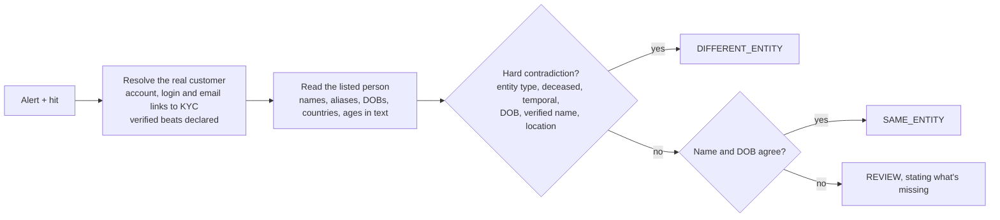

# Same Person or Not? — Deterministic Screening Resolver

**Grok Bot London Financial Crime Hackathon · Track 2: sanctions screening**

Every watchlist hit gets a decision (`SAME_ENTITY`, `DIFFERENT_ENTITY` or `REVIEW`), a policy reason code, a plain-English reason and the exact record IDs it rests on.

**No LLM. Python standard library only. $0 to run. The same input gives the same output, byte for byte.**

## Results on the dev set

| | |
|---|---|
| Practice labels | **50 / 50 correct**, 0 unsafe clearances, decision score 100 |
| Reason codes / customer records | 100% / 100% |
| Dev decisions (819 hits) | 464 cleared · 124 confirmed · 231 to review |
| Run time | about 20 s for the full dev set |
| Determinism | byte-identical across runs |
| Edge-case suite | **220 / 220** adversarial synthetic cases |
| Policy tests | **60 / 60** |
| Paraphrase stress test | 0 of 819 decisions changed after rewording |

## Why rules, not a model

Wrongly clearing a real sanctioned person costs 60 points, while an unnecessary review costs 2 to 3. The bank's policy is already rule-shaped, so we encoded it directly. This keeps the system deterministic, auditable and free to run, and anything it can't parse fails safe to `REVIEW`, never to a clearance.

## How it decides



## Run it

```bash
system/run <data folder> <output file>                     # e.g. system/run dev output/dev.jsonl
system/demo.sh <data folder> <out dir>                     # builds the offline demo viewer (index.html)
python3 system/tests/test_policy.py                        # 60 policy tests
python3 system/tests/edge_cases.py system/run              # 220 edge cases
python3 system/tests/paraphrase_check.py <dev> /tmp/pp     # rewording stress test
```

The demo viewer is a single offline HTML page. It shows the run overview, the reason-code chart, a searchable table of every hit, and for each hit a side-by-side comparison of the customer and the listed person, the resolution timeline, and evidence chips that open the raw records. Deep links work like `index.html#H-91AC66`.

See [`system/README.md`](system/README.md) for the full design, the edge cases and the limitations. No event data is committed.
