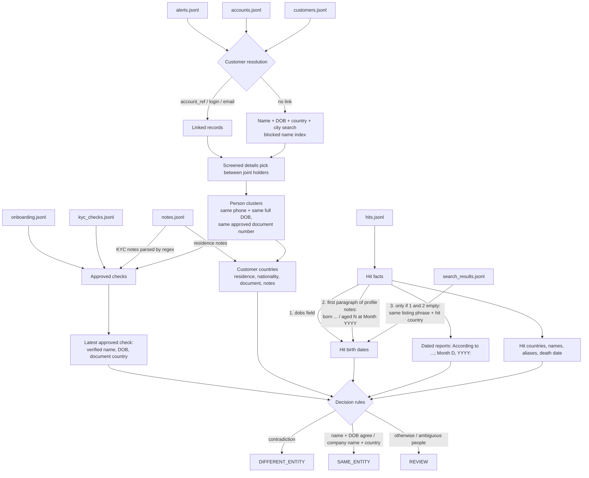

# Same Person or Not? — deterministic screening hit resolver

**No language model. Fully deterministic. Zero API cost.** The whole system is Python 3
standard library: rules taken from `POLICY.md`, name/date/country normalisation, regex
parsing of free text, and fuzzy string matching (bounded edit distance). It makes no
network calls and does not read `OPENROUTER_API_KEY`.

```
system/run <data folder> <output file>     # e.g. system/run dev output/dev.jsonl
```

| | |
|---|---|
| Run time on `dev/` (819 hits, 72k customers) | ~15–20 s on one core |
| Memory | < 1 GB |
| Cost | 0 (no API calls) |
| Practice labels (`validate.py --score`) | 50/50 decisions right, 0 unsafe clearances, decision score 100.0, reason code 100%, customer record 100% |

## Architecture



Files: `run` (shell entry point), `screen.py` (all logic), `countries.py` (country names,
ISO-2 codes, demonyms and territories → one canonical name).

## How the customer is resolved (principles 2–4)

1. **Follow the link.** `account_ref` → all holders of that account in `accounts.jsonl`;
   else `login_handle` → accounts; else `email` → `customers.email`.
2. **Joint accounts.** If the link reaches more than one person, the screened name, DOB,
   country and city pick between them (unknown parts never exclude a record).
3. **No link.** Candidate records come from a blocked name index (exact part, `name_variants`
   group members, 3-letter prefix and suffix blocks, so typos and variant spellings are still
   found); a record fits when a full/preferred/login name (or an approved verified name)
   agrees with the screened name, every DOB part both give is equal, the screened country is
   its residence/nationality and the screened city is in its city/address.
4. **One person, one picture.** Union-find over all 72k records: same phone digits + same
   full DOB, or the same document number on approved KYC checks, transitively.
5. **Verified beats declared.** For each person, every check is gathered: `kyc_checks` via
   accounts → onboarding → applicant, plus KYC notes from the support tool (filed by each
   record's email) parsed with regex (ALL-CAPS name run, the date after *born/DOB/birth date*,
   document country by name or demonym, negative wording such as *rejected/failed/expired*
   makes it not approved). Rejected/expired checks are ignored; the **latest approved**
   check supplies the legal name, DOB and document country.
6. **Several people fit** → the hit is decided for each; same decision → that decision with
   `customer_record_id = AMBIGUOUS`; different decisions → `REVIEW / AMBIGUOUS_CUSTOMER_RECORD`.

## How the listed person is resolved (principle 5)

* **Names:** `name`, `best_matching_name`, aliases, first/middle/last.
* **Countries:** `countries`, `nationality`, `citizenship`, last part of each address and of
  `place_of_birth`, `[Business]`-style tags stripped, "International"/"Europe" dropped.
  Any value we cannot map to a country **blocks a location clearance** (safety guard).
* **Birth dates** in priority order: `dobs` (ranges such as `1970-1972` expand to every
  year); the first paragraph of the profile notes (*"born on 1 May 1957"*, or an age at a
  dated event — *"aged 30 in November 1998"*, *"was 46 when questioned in January 2023"* —
  giving two possible years); only if neither exists, search results whose query has the
  same name parts, whose snippet contains the listing phrase of the hit's primary/first
  category (*"a politically exposed person"* …) **and** a country tied to the hit, with
  exactly one age and one date in the snippet. Every other namesake result is ignored.
  Only narrative statements in the notes count (*born …*, *aged N …*); raw scraped
  key–value fields such as `DOB: 6/20/1955` or `Age: 38` are not used as the hit's DOB.
* **Provider dates** keep only what is certain: a slash date whose day/month order cannot be
  told apart (e.g. `05/06/1970`) keeps just its year; `6/20/1955` is read as 20 June.
* **Earliest dated report:** only lines that start with `According to …; Month D, YYYY:`
  (case-sensitive, as the policy defines them); other wordings are ignored.
* **Death date:** the `deceased_date` field only. Deaths mentioned in free text are ignored
  because they are often about victims or relatives.

## Decision rules (principles 6–8)

Names are compared part by part after removing brackets, accents, punctuation, initials,
placeholders (NA, TEST, UNKNOWN, XXX, digits …) and, for companies, legal forms. Parts
match if identical, in the same `name_variants` group, joined/split (Abdulsalam = Abdul
Salam), or within 1 edit (4–6 letters) / 2 edits (7+); parts under 4 letters must be
identical; one-to-one matching. Names agree with ≥2 matching parts or all parts of the
shorter name.

Clear (`DIFFERENT_ENTITY`) only on a contradiction, in this priority order:
`ENTITY_TYPE_MISMATCH` → `DECEASED` (death before screening) → `TEMPORAL_IMPOSSIBILITY`
(maximum possible age < 16 at the earliest dated report, or company incorporated after it)
→ `DOB_MISMATCH` (every hit date contradicted: >1 year apart, or same year with different
month/day) → `NAME_MISMATCH_VERIFIED` (verified legal name, ≥2 real parts, agrees with none
of the hit's names) → `LOCATION_MISMATCH` (all customer countries disjoint from all hit
countries, never when name and DOB agree). Confirm (`SAME_ENTITY`) an individual when name
and DOB agree and nothing contradicts them (`NAME_DOB_LOCATION_MATCH` if a country is
shared, `NAME_DOB_MATCH` if either side has no country); if their countries are disjoint the
hit is `REVIEW`, because a country difference can neither clear nor be ignored. A company is
confirmed when name and country agree (`NAME_LOCATION_MATCH`). If name and DOB agree but
something contradicts, or nothing settles it → `REVIEW / INSUFFICIENT_DATA`. Without a
resolved customer the system never clears or confirms on screened (declared) data.

## Evidence representation

Every fact carries the ID of the record it came from (customer records for residence and
nationality, the KYC check or note for verified name/DOB/document country, the support note
for places lived, the search result for a hit DOB). The output cites only the sources of
the facts that decided the hit: e.g. a DOB mismatch cites just the check that gave the DOB
(plus the SR if the hit DOB came from search); a location mismatch cites all sources of the
customer's countries; a match cites the person's records plus the DOB source. The `reason`
restates the decisive facts with this hit's own values and IDs.

## Determinism

No randomness, no clocks, no network, no model. All iteration over sets/dicts is sorted
(alerts, hits, records, notes, evidence lists); ties between checks on the same date are
broken by source and ID. Two consecutive runs produce byte-identical output (verified with
`cmp`).

## Worked cases (real dev data)

**Clear mismatch — H-58A39C (A-2642A1), `DIFFERENT_ENTITY / DOB_MISMATCH`.** The alert's
`account_ref ACC-C0984C` has joint holders CUS-604925 and CUS-022310; the screened name and
DOB pick CUS-604925. Its latest approved check KYC-232AE0 verifies DOB 1965-03-28. The hit
Timothy Pangelinan Villagomez lists DOB 1962-09-10 only — three years apart, so every hit
date is contradicted. Evidence: `["KYC-232AE0"]`.

**Match — H-91AC66 (A-7EE3F4), `SAME_ENTITY / NAME_DOB_LOCATION_MATCH`.** `ACC-8AEABB` →
joint holders, screened details pick CUS-962814 → onboarding APP-687828 → latest approved
check KYC-038F14: Emran Ali, born 1994-11-01, Bangladeshi passport. The hit Emran Ali has
`dobs` 1994/1995 and Bangladesh addresses. Name, DOB and country agree and nothing
contradicts. Evidence: `["CUS-962814", "KYC-038F14"]`.

**Left for review — H-DC05D5 (A-5A258E), `REVIEW / INSUFFICIENT_DATA`.** `ACC-1A547E` →
CUS-293016 → KYC-16E55D verifies TIJJANI ABDLULAHI (DOB 1984-07-10, Nigeria). The hit
"Abdullahi, Tijjani" (adverse media, Nigeria) has no DOB in `dobs`, no age in its notes,
and no attributable search result. Names agree (Abdlulahi ≈ Abdullahi within 2 edits),
countries agree, nothing contradicts, but without a hit DOB the hit can be neither cleared
nor confirmed. Evidence: `["CUS-293016", "KYC-16E55D"]`.

## Tests

`python3 system/tests/test_policy.py` builds tiny data folders for the rare policy cases and
checks the decision: company incorporated after the earliest report, too young / exactly 16
at the report, death before screening, a document-number link that adds a country, a shared
phone that does not merge people, rejected and expired checks and a rejected KYC note
ignored, latest approved check wins, partial dates (year vs full date, same year different
month, one year apart), an age at a date giving two years, name+DOB agreeing with different
countries, a single-part placeholder name, two people fitting with different decisions,
person vs company, namesake search results with the wrong role or country, and an
unrecognised country. All 20 pass.

## Robustness testing

`python3 system/tests/paraphrase_check.py dev /tmp/para` rewrites the free text of the data
folder while keeping every fact: KYC notes in four new sentence shapes with five date
formats and 30% Title-case names, residence notes reworded, every search snippet rebuilt in
three new shapes (name/age/role/country/month in different orders, "(37)", "aged 37",
"the 37-year-old"), and profile-note age sentences replaced with new templates ("X (37) was
questioned in May 1999", "then 37 years of age", "at the age of 37"). It then reruns the
system: **0 of 819 decisions change**. Earlier rounds of this test exposed bugs that would have
caused unsafe clearances or missed facts (a check date read as the birth date; "United States"
read as a person's name; sentence splitting after an initial such as "Mark E. Phillips";
parenthesised ages); all are fixed.

## Honest limitations

* Free-text parsing is regex based. KYC notes whose verified name is not written in
  capitals fall back to a Title-case pattern, and such names are never used to clear on
  `NAME_MISMATCH_VERIFIED`. Unusual age/DOB phrasings in profile notes or search snippets that
  the patterns miss lead to `REVIEW` (safe direction), not to a clearance.
* Country recognition uses a built-in gazetteer (≈230 countries/territories, ISO-2 codes,
  demonyms). An unrecognised country value blocks location clearance rather than being
  ignored.
* Day/month order of slash dates is read as DD/MM/YYYY, as in the bank's systems.
* Safety guards that only ever turn a clearance into `REVIEW`: an unrecognised country value;
  a screened country that none of the customer's records carry; a KYC-note name we could not
  parse confidently (it is never used for `NAME_MISMATCH_VERIFIED`); name and DOB agreeing
  while something else contradicts.
